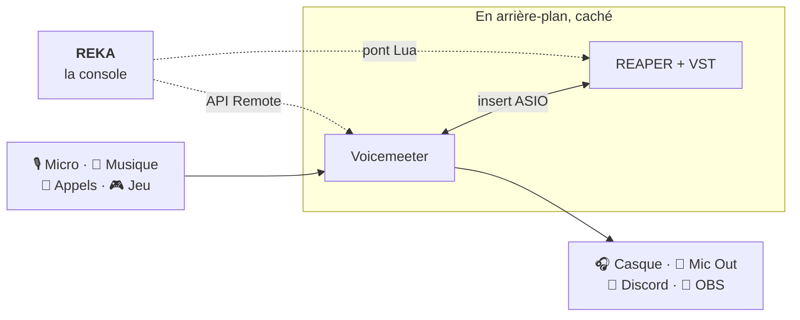

<p align="center">
  
</p>

<h3 align="center">La console de mixage tout-en-un pour Voicemeeter,<br>avec effets VST en temps réel.</h3>

<p align="center">
  <a href="https://github.com/regret-py/reka/releases/tag/build-latest"></a>
  <a href="https://github.com/regret-py/reka/actions/workflows/build-windows.yml"></a>
  
  
  
</p>

<p align="center">
  <a href="https://github.com/regret-py/reka/releases/download/build-latest/REKA.exe"></a>
</p>

<p align="center">
  
</p>

---

## Pourquoi REKA ?

Voicemeeter est puissant, mais austère. Et appliquer des effets VST à sa voix demande de
jongler entre Voicemeeter, une station audio, l'insert ASIO et une dizaine de fenêtres.

**REKA réunit tout dans une seule console.** Voicemeeter et le moteur d'effets tournent
cachés en arrière-plan : tu ne vois que tes faders, tes VU-mètres et tes plugins. Micro,
musique, appels, jeu, Discord, OBS : chaque source a sa strip, ses effets et ses envois.

## Fonctionnalités

| Fonction | En détail |
|---|---|
| 🎚️ **Console complète** | 6 strips (Potato) ou 5 (Banana) : faders de -60 à +12 dB, mute, VU-mètres en temps réel, Intellipan |
| 🔀 **Routing en un clic** | envois Monitor, Mic Out, Discord et Obs sur chaque strip, niveau réglable au demi-décibel |
| 🎛️ **Effets VST par strip** | VST2, VST3 et CLAP : ajout, bypass, interface du plugin, projets REAPER |
| ⚙️ **4 moteurs d'effets** | REAPER, FL Studio, Equalizer APO, ou aucun : chacun indique le délai qu'il ajoute |
| ⏱️ **Latence maîtrisée** | délai de chaque chaîne d'effets affiché en ms, plugins à anticipation signalés, tampon Voicemeeter réglable |
| 🔊 **Volume par application** | Discord, Spotify, jeu, navigateur : volume, niveau et mute de chaque application sur sa strip |
| 🎵 **Musique en cours** | pochette, titre, artiste et commandes du lecteur actif (Spotify, Deezer, YouTube…) |
| 🎨 **Personnalisable** | 9 thèmes et couleurs libres, couleur de chaque élément, image de fond, noms des canaux |
| 🔄 **Mises à jour automatiques** | nouvelle version téléchargée, vérifiée et installée au lancement, sans rien demander |
| 🛡️ **Robuste** | moteur d'effets qui plante : REKA continue sans effets ; hors ligne ou config abîmée : démarrage normal |

## Installation

1. **[Télécharge REKA.exe](https://github.com/regret-py/reka/releases/download/build-latest/REKA.exe)** :
   un seul fichier, rien à installer.
2. **Lance-le.** Au premier démarrage, REKA te demande ton édition de Voicemeeter et ton
   moteur d'effets, en indiquant ce qui est déjà installé sur ton PC.
3. **C'est prêt.** Les mises à jour arrivent ensuite toutes seules.

> [!TIP]
> Pas encore de Voicemeeter ? `REKA.exe --demo` ouvre la console avec des moteurs simulés,
> pour la découvrir sans rien installer.

> [!NOTE]
> REKA.exe n'est pas signé : au premier lancement, Windows SmartScreen peut afficher
> « Windows a protégé votre ordinateur ». Clique sur **Informations complémentaires**,
> puis **Exécuter quand même**.

### Prérequis

- **Système** : Windows 10 ou 11, 64 bits
- **Mixage** : [Voicemeeter Potato](https://vb-audio.com/Voicemeeter/potato.htm) ou
  [Voicemeeter Banana](https://vb-audio.com/Voicemeeter/banana.htm)
- **Effets**, au choix : [REAPER](https://www.reaper.fm/download.php) (6.37 ou plus récent),
  [FL Studio](https://www.image-line.com/),
  [Equalizer APO](https://sourceforge.net/projects/equalizerapo/), ou aucun

Si un logiciel manque, REKA affiche son lien de téléchargement, ou permet de le localiser
s'il est installé ailleurs.

## Comment ça marche



- **Voicemeeter** est piloté par son API Remote : réglages instantanés, niveaux lus 30 fois
  par seconde.
- **REAPER** reçoit le son de chaque strip par l'insert de Voicemeeter, applique ses
  plugins et le renvoie. REKA le commande par un petit script Lua, sans aucun réglage
  manuel. FL Studio et Equalizer APO sont aussi pris en charge.
- **À la fermeture**, REKA sauvegarde le projet, rend les inserts et ferme proprement les
  logiciels qu'il a lancés. Un Voicemeeter ouvert avant lui n'est jamais fermé.

## Mises à jour

À chaque lancement, REKA vérifie s'il existe une nouvelle version. S'il y en a une, il la
télécharge, contrôle son intégrité (taille et empreinte SHA-256), remplace `REKA.exe` et
redémarre dessus. Tes réglages et tes projets sont conservés (`%APPDATA%\REKA`). Hors
ligne, REKA démarre normalement après 4 secondes au plus.

L'installation automatique peut être désactivée dans ⚙ → **À propos** : REKA signale alors
simplement qu'une mise à jour est disponible.

## Documentation

Le guide complet est dans **[reaper_mixer/README.md](reaper_mixer/README.md)** :

- [Premier lancement : faire passer le son par les effets](reaper_mixer/README.md#premier-lancement--faire-passer-le-son-par-les-effets)
- [Utilisation de la console](reaper_mixer/README.md#utilisation)
- [Moteurs d'effets : REAPER, FL Studio, Equalizer APO](reaper_mixer/README.md#moteurs-deffets--reaper-fl-studio-equalizer-apo-ou-aucun)
- [Délai de la voix](reaper_mixer/README.md#délai-de-la-voix)
- [Volume par application](reaper_mixer/README.md#volume-par-application)
- [Personnaliser l'interface](reaper_mixer/README.md#personnaliser-linterface)
- [Dépannage](reaper_mixer/README.md#dépannage)

## Développement

<details>
<summary><b>Lancer REKA depuis les sources</b></summary>

<br>

Python 3.11 ou plus récent (testé en 3.12 et 3.13).

```bash
cd reaper_mixer
python -m pip install -r requirements.txt pytest
python main.py --demo        # console avec moteurs simulés
python -m pytest tests       # tests
python -m PyInstaller --noconfirm --clean build.spec   # → dist/REKA.exe
```

| Brique | Technologie |
|---|---|
| Interface | PySide6 (Qt 6), widgets dessinés sur mesure |
| Voicemeeter | API Remote (`voicemeeter-api`) |
| REAPER | pont Lua (`assets/reka_bridge.lua`) |
| Audio Windows | Core Audio (`pycaw`), contrôles média WinRT |
| Exécutable | PyInstaller, un seul fichier |

À chaque push, GitHub Actions lance les tests sous Linux et Windows, construit
`REKA.exe`, vérifie son rendu par un auto-test, puis, sur la branche principale, le publie
dans la release **build-latest**, celle où tous les REKA installés cherchent leurs mises à
jour.

</details>

## Crédits

Développé par **Regret** et **Zerka**.

<sub>Police [Inter](https://rsms.me/inter/) sous licence SIL Open Font License. Voicemeeter
est un logiciel de VB-Audio, REAPER de Cockos, FL Studio d'Image-Line ; REKA n'est affilié
à aucun d'eux.</sub>
