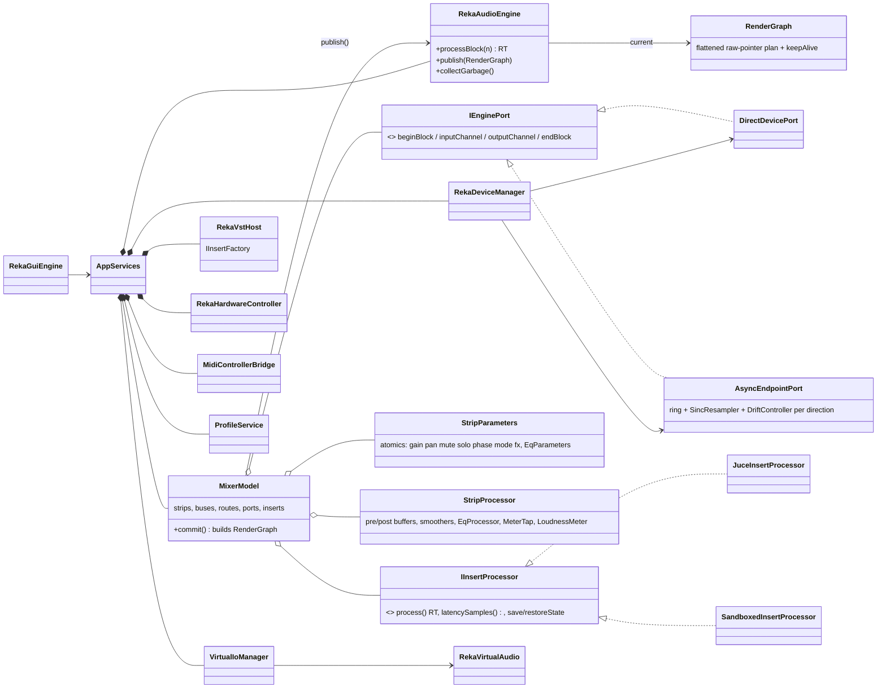
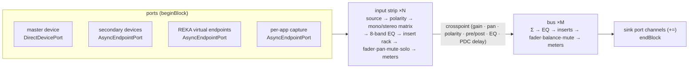
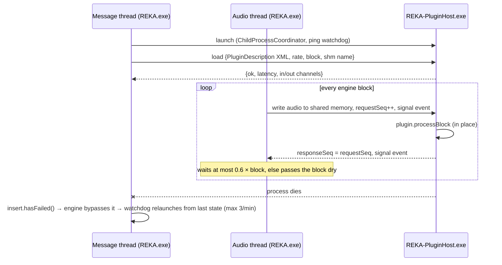
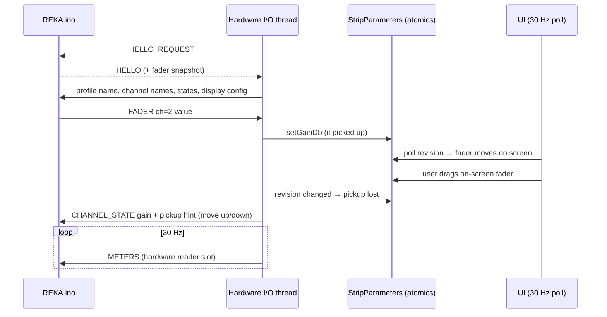

# REKA architecture

REKA is split into three deliverables that share one contract each:

| Deliverable | Technology | Shares with the others |
|---|---|---|
| `REKA.exe` | C++20, JUCE 8 (devices, VST3, UI), `reka_core` (engine) | `RekaProtocol.h` (with the firmware), `SandboxProtocol.h` + `SharedAudioChannel` (with the plugin host), `RekaDriverInterface.h` (with the kernel driver) |
| `REKA-PluginHost.exe` | C++20, JUCE 8, `reka_core` | the plugin sandbox protocol |
| `REKA.ino` | Arduino C++11 (Pro Micro, Teensy 4.x, ESP32) | `RekaProtocol.h` |

The real-time engine, DSP, profiles, hardware bridge and platform layer live in **`reka_core`**, a static library with
**no JUCE dependency**. It builds and is unit-tested on Windows, Linux and macOS, and it is the only code that runs on
the audio thread.

---

## 1. Project tree

```
reka/
├── CMakeLists.txt                 options: REKA_BUILD_APP, REKA_BUILD_TESTS, REKA_ENABLE_ASIO, REKA_BUILD_INTEGRATION_TESTS
├── cmake/                         compiler settings, pinned dependencies (JUCE 8.0.12, nlohmann/json 3.11.3, doctest 2.4.11)
├── src/
│   ├── core/reka/                 ── reka_core (JUCE-free) ──────────────────────────────────────────
│   │   ├── common/                Types, Base64, ScopedFlushDenormals
│   │   ├── lockfree/              SpscQueue, AudioRingBuffer
│   │   ├── dsp/                   Biquad, ParametricEq (8 bands), Smoothing (de-click ramps), PanLaw, FaderLaw,
│   │   │                          DelayLine (PDC), MeterTap (peak/RMS), LoudnessMeter (BS.1770 / R128),
│   │   │                          SincResampler + DriftController (SRC + clock-drift lock)
│   │   ├── io/                    IEnginePort, DirectDevicePort (master), AsyncEndpointPort (any other clock), SoftwareClock
│   │   ├── engine/                RekaAudioEngine (RT renderer), MixerModel (topology), RenderGraph, Parameters,
│   │   │                          StripProcessor, InsertProcessor interface
│   │   ├── profile/               Profile (.reka JSON), capture + hot-apply (diff)
│   │   ├── hardware/              RekaHardwareController (serial I/O thread), PickupFilter, ISerialPort
│   │   ├── platform/              SerialPortWin32/Posix, SharedAudioChannel (sandbox IPC), ThreadPriority (MMCSS),
│   │   │                          WindowBackdrop (Mica/Acrylic)
│   │   └── virtualaudio/          RekaVirtualAudio facade, RekaDriverInterface.h (IOCTL contract),
│   │       └── win/               driver client + ring pump, WASAPI endpoint enumeration, process-loopback capture
│   ├── app/                       ── REKA.exe (JUCE) ────────────────────────────────────────────────
│   │   ├── Main.cpp               JUCEApplication, single instance, --smoke-test
│   │   ├── AppServices            composition root, housekeeping timer, crash watchdog for plugins
│   │   ├── ProfileService         load / save / hot reload / file watch / autosave
│   │   ├── AppSettings            machine-level preferences, AppPaths
│   │   ├── audio/                 RekaDeviceManager (master + secondary devices), VirtualIoManager
│   │   ├── vst/                   RekaVstHost, JuceInsertProcessor, SandboxedInsertProcessor, PluginBlockAdapter,
│   │   │                          SandboxProtocol.h
│   │   ├── hardware/              MidiControllerBridge (MIDI learn, soft takeover, feedback)
│   │   └── gui/                   RekaGuiEngine, Theme + UiLayout, RekaLookAndFeel, MainComponent,
│   │       └── components/        StripComponent, MixerPanel, MeterComponent, GainControl, EqEditor, InsertRack,
│   │                              RoutingMatrixPanel, PluginBrowserPanel, SettingsPanel, ThemeEditorPanel
│   └── pluginhost/                ── REKA-PluginHost.exe ── scanner + sandbox worker
├── firmware/
│   ├── platformio.ini             envs: promicro, teensy41, esp32dev (src_dir = REKA, so the Arduino IDE works too)
│   └── REKA/                      REKA.ino, RekaConfig.h (pins/features), RekaProtocol.h (wire contract)
├── resources/                     built-in themes (JSON), starter profile (default.reka) - embedded as binary data
├── tests/                         doctest unit tests for reka_core; integration/ = test VST3 + hosting test
└── docs/                          this file, protocol, driver, profile format, themes, wiring
```

---

## 2. Class hierarchy



---

## 3. Threading model

| Thread | Owner | Runs | May touch | Never |
|---|---|---|---|---|
| **Audio** (master device callback, or `SoftwareClock`) | JUCE device / REKA | `RekaAudioEngine::processBlock` | the current `RenderGraph`, parameter atomics, port block buffers, ring buffers (lock-free side), inserts' `process()` | allocate, free, lock, wait, log, call the OS (except `steady_clock`) |
| **Secondary device threads** | JUCE (WASAPI / DirectSound) | `Secondary::audioDeviceIOCallback` | their `AsyncEndpointPort` endpoint side only | the engine or the model |
| **Virtual endpoint pumps** | REKA (`win/RekaDriverClient`) | ring ↔ port copy, MMCSS "Pro Audio" | the driver's shared ring, their port | the model |
| **Process-loopback capture** | REKA (`win/ProcessLoopbackCapture`) | WASAPI event loop, MMCSS | their port | the model |
| **Hardware I/O** | `RekaHardwareController` | serial read/write, protocol, 30 Hz feedback | `StripParameters` atomics, `MeterTap` hardware reader slot, an immutable `HardwareBindings` snapshot | the model, the UI |
| **MIDI input** | JUCE | `MidiControllerBridge::handleIncomingMidiMessage` | parameter atomics through a mutex-guarded binding list | the audio thread's data except atomics |
| **Sandbox IPC** (one per sandboxed plugin) | JUCE `ChildProcessCoordinator` | replies / notifications | its own request map (mutex + condvar) | the engine |
| **Plugin scan** | `RekaVstHost::ScanThread` | launches one `REKA-PluginHost --scan` per file | `KnownPluginList` (internally locked) | plugins in-process |
| **Message (UI)** | JUCE | UI, `MixerModel`, profiles, `AppServices` 20 Hz timer | everything non-real-time; publishes graphs, collects garbage | block on the audio thread |

**Rules that keep the audio thread real-time safe**

1. **Parameters are atomics.** Faders, pans, mutes, solos, polarity, mono/stereo mode, EQ bands and route levels are
   `std::atomic` (static-asserted lock-free). Writers bump a revision counter so observers (UI, hardware, MIDI) can
   poll cheaply. A parameter change never touches the graph.
2. **Topology changes are RCU.** `MixerModel` builds a new immutable `RenderGraph` on the message thread and
   `publish()`es it through a single atomic pointer. At the next block boundary the audio thread swaps it in and
   pushes the old graph onto a lock-free `SpscQueue`. `collectGarbage()` deletes it later on the message thread.
   `keepAlive` holds a `shared_ptr` to every object the graph's raw pointers reference, so a strip removed while
   audio runs is destroyed on the message thread, never mid-block. Plugin instances therefore always die on the
   message thread, which JUCE/VST3 require.
3. **DSP state survives graph swaps.** `StripProcessor` and `CrosspointProcessor` are owned by the model, not the graph,
   so filter states, smoothers and meters are continuous across edits. Adding a strip or plugin never clicks.
4. **Everything audible is ramped.** Gain, pan, mute, solo, route on/off and polarity go through `SmoothedValue`, a
   block-rate one-pole with an intra-block linear ramp of about 15 ms, independent of block size.
5. **No denormals.** Every RT entry point uses `ScopedFlushDenormals` (FTZ/DAZ on x86, FZ on ARM64).
6. **Bounded waits only.** The only wait on the audio path is the sandboxed insert's, which is bounded at 0.6 × block
   duration and passes audio dry on timeout. Sequence numbers make a late answer harmless.

Verified by: the RCU stress test (`test_engine.cpp`, topology edits while another thread renders), clean
ThreadSanitizer runs of the whole unit suite, and AddressSanitizer runs of the app.

---

## 4. One engine block



* Strips and buses are processed as **stereo pairs**. Mono sources are duplicated on entry and mono sinks receive
  (L+R)/2, so the render loop has no per-channel branching.
* **Mono/stereo summing** per strip: Stereo, Mono `(L+R)/2`, Swap, Left-only, Right-only. Mono-type modes switch the pan
  law from balance to the configurable mono pan law (constant power −3 dB, constant power with unity centre, linear).
* **Solo-in-place**: when any input is soloed, every other input is ramped to silence. Buses have their own solo group.
* **Pre-fader sends** tap the strip before its fader, so a monitor mix survives muting the strip.
* **Plugin delay compensation**: for each bus, every enabled route is delayed up to the slowest input's insert-chain
  latency. Bypassed latent plugins are replaced by an equal delay, so bypassing never shifts timing. Plugins report
  latency changes asynchronously and the message thread re-plans the graph.
* Driver blocks larger than the prepared size are split internally (some drivers lie about buffer sizes).

---

## 5. Clock domains

Only one device clocks the engine (the **master**: ASIO, WASAPI exclusive or low latency, or the software clock).
Every other endpoint has its own clock, crystal and often its own sample rate. `AsyncEndpointPort` bridges each one:

```
endpoint thread ──write──▶ [lock-free ring] ──▶ SincResampler (ratio from DriftController) ──▶ engine    capture
engine ──▶ SincResampler ──▶ [lock-free ring] ──read──▶ endpoint thread                                   render
```

* **One interpolation stage per hop** does both sample-rate conversion (e.g. a 44.1 kHz headset into a 48 kHz engine)
  and drift correction: 64-tap Kaiser-windowed sinc, 512 phases, under −80 dB THD+N in the tests.
* **DriftController**: observes the ring for 0.5 s and adopts the average fill as its set point. A critically damped
  PI loop (ωn ≈ 0.05 rad/s) then trims the ratio by at most ±0.5 %. A 150 ppm crystal mismatch converges to exactly
  150 ppm of correction (unit-tested), well below audible pitch change.
* Under- and overruns re-prime the stream instead of glitching repeatedly. A stalled engine discards its backlog
  rather than keeping it as latency.

---

## 6. Plugin hosting and the sandbox



* **Scanning** runs each plugin file in its own `REKA-PluginHost --scan` process. A file that crashes or hangs (60 s)
  is blacklisted and does not stop the scan.
* **In-process** inserts (`JuceInsertProcessor`) are the lowest-overhead option. **Sandboxed** inserts are the default;
  per plugin it can be switched at any time from the slot menu, and state is carried over.
* Plugin editors open in their own window; a sandboxed plugin's editor is owned by its sandbox process.
* Verified end to end by `tests/integration` against a purpose-built VST3: out-of-process scan, both hosting modes,
  latency, state round-trip, sandbox crash detection and relaunch.

---

## 7. Profiles and hot reload

`ProfileService::apply()` hands each subsystem its section of the `.reka` file. Each subsystem diffs against its live
state:

| Section | Applied by | Restarts something only when |
|---|---|---|
| `audio.master` / `audio.secondary` | `RekaDeviceManager::restoreState` | the master device, rate or buffer differs, or a secondary device was added or removed |
| `audio.virtual` | `VirtualIoManager::restoreState` | an endpoint or app capture was added or removed |
| `mixer` | `applyMixerState` (core, unit-tested) | never. Strips, DSP state and plugin instances whose identity and state are unchanged are kept. Everything is published as **one** graph |
| `hardware` | `AppServices::applyHardwareSettings` | the serial port, baud rate or enable flag changed |
| `ui` | `RekaGuiEngine::setLayout` | n/a (UI only) |

The file is watched: editing a `.reka` file in a text editor reloads it within a second, and so does editing a user
theme. An autosave runs every minute and on exit, for crash recovery.

---

## 8. Control surface loop



Soft takeover (`PickupFilter`) keeps non-motorised faders from jumping: after an on-screen or profile change, the
physical fader is ignored until it reaches or crosses the new value. The OLED shows an arrow telling the user which
way to move. On-screen faders, physical faders and MIDI share one `FaderLaw`, so equal positions mean equal dB.

---

## 9. Verification matrix

| What | How | Where |
|---|---|---|
| DSP correctness (EQ, pan laws, fader law, ramps, delay, meters) | unit tests | `tests/test_dsp.cpp` |
| Loudness | EBU Tech 3341 case 1 at 44.1/48/96 kHz, relative gate | `tests/test_dsp.cpp` |
| SRC + drift lock | THD+N < −80 dB, 150 ppm lock, 44.1→48 kHz bridge | `tests/test_resampler.cpp` |
| Engine | routing, gain, solo/mute, polarity, mono, pre-fader, PDC, latency-matched bypass, failed insert, RCU stress | `tests/test_engine.cpp` |
| Profiles | JSON round trip, validation, hot-reload reuse | `tests/test_profile.cpp` |
| Protocol | CRC check value, COBS, corruption fuzz, payload bounds | `tests/test_protocol.cpp` |
| Hardware bridge | simulated REKA.ino: handshake, names, pickup, buttons, solo flags, meters | `tests/test_hardware.cpp` |
| Sandbox IPC | real cross-thread shared memory, stall and recovery | `tests/test_sandbox_channel.cpp` |
| Plugin hosting | real VST3 through scan / in-process / sandbox / crash | `tests/integration` |
| Threading | ThreadSanitizer, AddressSanitizer + UBSan on the unit suite and app smoke test | CI |
| Windows code | MSVC in CI; MinGW cross-compile and link during development | CI / dev |
| Firmware | PlatformIO for Pro Micro, Teensy 4.1, ESP32 | CI |
