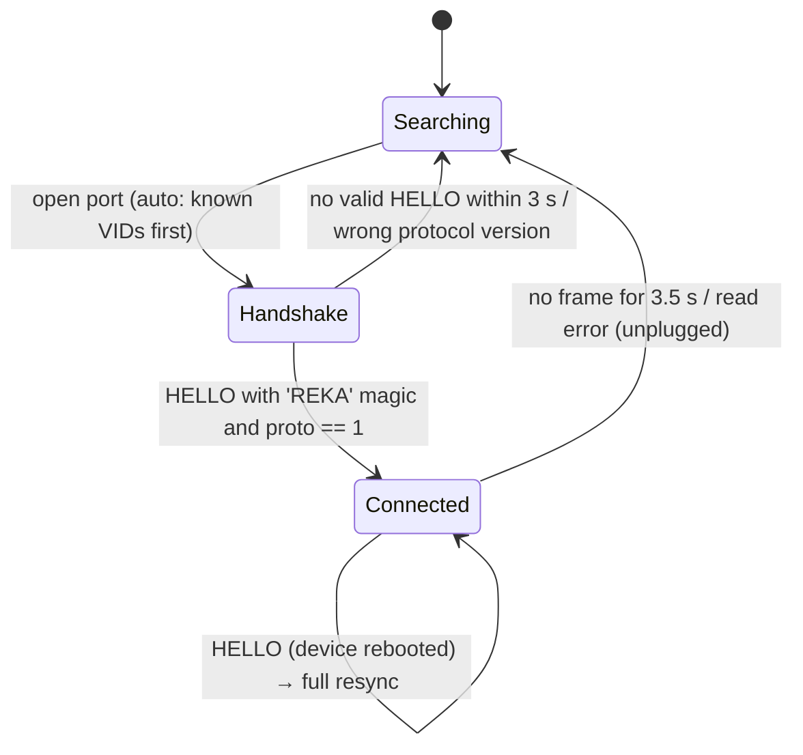

# REKA control-surface protocol (v1)

The protocol between `REKA.exe` (host) and `REKA.ino` (device). The only source of truth is
[`firmware/REKA/RekaProtocol.h`](../firmware/REKA/RekaProtocol.h), which both sides compile: avr-gcc in C++11 on a
2.5 KB-RAM Pro Micro, and C++20 on the desktop. This page explains it.

## Transport

| | |
|---|---|
| Link | USB CDC (native USB boards) or UART behind a USB bridge (ESP32 DevKit), 115200 8N1 |
| Line state | the host asserts **DTR and RTS** on open. ATmega32U4 drops output while DTR is low; DTR+RTS together is the reset-neutral state of the ESP32 auto-reset circuit |
| Framing | [COBS](https://en.wikipedia.org/wiki/Consistent_Overhead_Byte_Stuffing). Every frame ends with `0x00`; back-to-back delimiters are legal keep-alives |
| Raw frame | `[type][payload … ≤ 40 bytes][crc8]` |
| Integrity | CRC-8/SMBUS (poly 0x07, init 0x00) over `type + payload`; check value of "123456789" is `0xF4` |
| Endianness | big-endian for multi-byte integers |
| Robustness | the parser drops oversize frames until the next delimiter, rejects bad CRCs and counts errors; both sides validate payload sizes and channel indices and ignore malformed messages |

## Messages

### Device → host

| Type | Name | Payload | Notes |
|---|---|---|---|
| `0x01` | `HELLO` | `proto u8, fwMajor u8, fwMinor u8, numChannels u8, capabilities u8, 'R','E','K','A'` | sent at boot, on port open (native USB) and in reply to `HELLO_REQUEST`. Capabilities: `0x01` faders, `0x02` buttons, `0x04` LEDs, `0x08` OLED, `0x10` USB-MIDI, `0x20` encoders |
| `0x02` | `FADER` | `channel u8, value u16` | value 0…65535 = normalised travel. Rate-limited to 1 per 4 ms per channel, the resting value is always sent; ends are exact 0 / 65535 |
| `0x03` | `BUTTON` | `channel u8, button u8, pressed u8` | button: 0 mute, 1 solo, 2 FX bypass, 3 select. Press and release edges, debounced on the device |
| `0x04` | `FADER_SNAPSHOT` | `first u8, count u8, value u16 × count` | sent after `HELLO`; split across frames when needed |
| `0x05` | `PONG` | `token u8` | reply to `PING` |
| `0x06` | `ENCODER` | `channel u8, delta i8` | reserved for rotary encoders |

### Host → device

| Type | Name | Payload | Notes |
|---|---|---|---|
| `0x81` | `HELLO_REQUEST` | `proto u8` | the host sends it every 500 ms during the handshake, then once more at session start to get a fresh fader snapshot |
| `0x82` | `CHANNEL_STATE` | `channel u8, flags u8, gain i16, pickup i8` | flags: `0x01` mute, `0x02` solo, `0x04` FX bypass, `0x08` mapped, `0x10` selected, `0x20` clip (held 1 s), `0x40` solo-implied mute (another channel is soloed). Gain is in tenths of a dB, `-32768` = −∞. Pickup: `+1` move up, `-1` move down, `0` in control |
| `0x83` | `CHANNEL_NAME` | `channel u8, len u8, chars…` | ≤ 8 characters (OLED width); the host truncates |
| `0x84` | `METERS` | `first u8, count u8, level u8 × count` | 30 Hz. Level `0` = ≤ −60 dBFS, `1…240` = −60…0 dBFS in 0.25 dB steps (`dB = level/4 − 60`), `255` = clipped |
| `0x85` | `PROFILE_NAME` | `len u8, chars…` | ≤ 16 characters |
| `0x86` | `PING` | `token u8` | every 1 s |
| `0x87` | `SELECT` | `channel u8` | the channel shown large on the OLED |
| `0x88` | `DISPLAY_CONFIG` | `ledBrightness u8, oledContrast u8, numMappedChannels u8` | |

## Connection state machine

On entering **Connected** the host sends `HELLO_REQUEST` (to get a fresh fader snapshot), `PROFILE_NAME`,
`DISPLAY_CONFIG`, `CHANNEL_NAME` and `CHANNEL_STATE` for every channel, then `SELECT`. After that it sends:

* `CHANNEL_STATE` only when a channel's flags, gain or pickup hint changes. Changes made on screen, by MIDI or by
  a profile reload are detected through `StripParameters::revision()` and mirrored within one 33 ms tick;
* `METERS` every 33 ms, from the strip's dedicated hardware meter reader, so UI peaks are never stolen;
* `PING` every second.

The device treats more than 3 s of silence from the host (or the port closing) as disconnected. It then shows the
waiting screen and the idle LED animation.

## Semantics

* **The host is the single source of truth.** A button press only sends `BUTTON`. LEDs and the OLED change when
  the host answers with `CHANNEL_STATE`, so on-screen and physical state can never disagree.
* **Soft takeover.** Physical faders are not motorised. After the value changes elsewhere, the host ignores the
  fader until it reaches or crosses the new value (±1.5 % tolerance), and meanwhile sends a pickup hint the OLED
  shows as ▲/▼. See `reka::PickupFilter`.
* **One fader law everywhere.** `reka::FaderLaw` maps 0…1 to dB (0 → −∞, 0.05 → −60, 0.25 → −30, 0.5 → −10,
  0.75 → 0, 1 → +12 dB) for physical faders, on-screen faders and MIDI alike.
* **Channel mapping.** Physical channel *n* controls the *n*-th strip of `hardware.map` in the profile. If that list
  is empty it controls the *n*-th strip in on-screen order (inputs first, then buses).

## Versioning

`kProtocolVersion` is checked during the handshake. A device on another version is reported in the UI ("update
REKA.ino") and not used. New message types may be added within a version, and both sides ignore types they do not
know. Changing an existing payload layout requires bumping the version.
